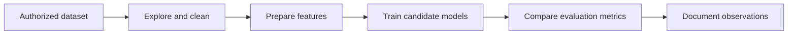

# Machine Learning Internship Projects


A portfolio of three notebook-based classification exercises completed during a CodSoft machine-learning internship. The work covers customer churn, credit-card fraud, and SMS spam, with emphasis on preprocessing, model comparison, and evaluation.

## Projects

| Notebook | Problem | Methods explored |
| --- | --- | --- |
| [TSK1.ipynb](TSK1.ipynb) | Customer churn prediction | Categorical encoding, scaling, Logistic Regression, Random Forest, XGBoost |
| [TSK2.ipynb](TSK2.ipynb) | Credit-card fraud classification | Encoding, feature scaling, Logistic Regression, Decision Tree, Random Forest |
| [TSK3.ipynb](TSK3.ipynb) | SMS spam classification | Text preprocessing, TF-IDF, Multinomial Naive Bayes, Logistic Regression |

## Workflow



The notebooks are learning experiments. Their results depend on the input data, preprocessing, and split strategy; no performance claim is made here.

## Run locally

The notebooks expect external datasets that are not included. Update each notebook's `read_csv` path to point to a dataset you are authorized to use. Do not commit private or licensed data.

```bash
 git clone https://github.com/Sameer-ship-it/CODSOFT.git
 cd CODSOFT
 python -m venv .venv
```

Activate the environment, then install the notebook dependencies:

```powershell
.venv\Scripts\Activate.ps1
python -m pip install jupyter pandas numpy scikit-learn matplotlib seaborn xgboost category-encoders
jupyter notebook
```

On macOS or Linux, activate with `source .venv/bin/activate`.

## Notes

- These are educational notebooks, not production fraud, churn, or spam detection systems.
- For imbalanced datasets, review precision, recall, F1 score, and the confusion matrix alongside accuracy.
- Check dataset licensing and remove personal identifiers before sharing results.
